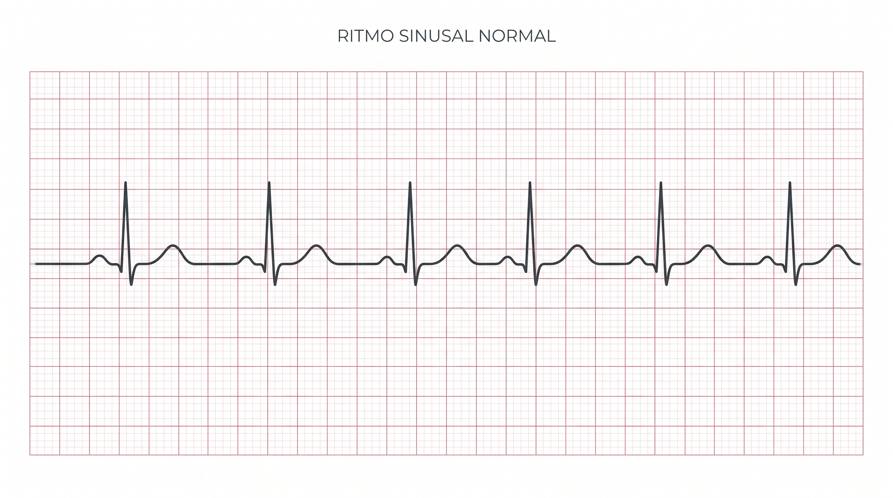
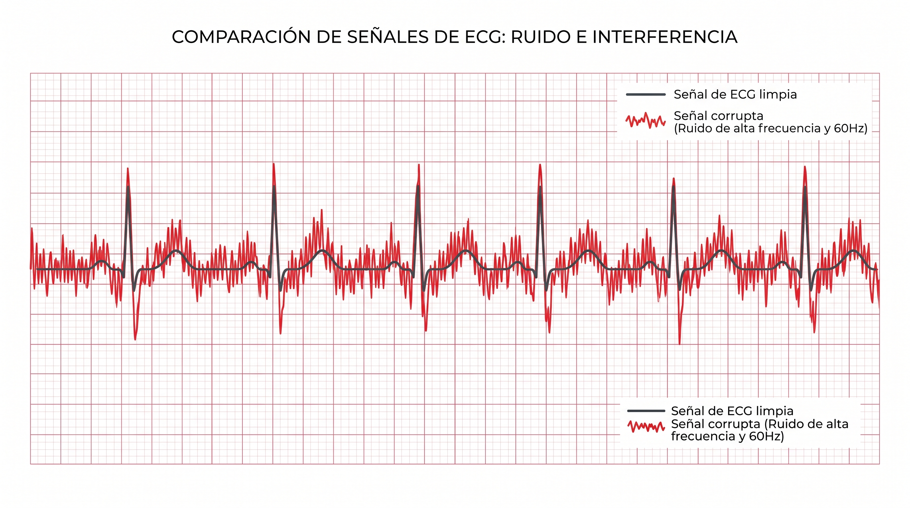
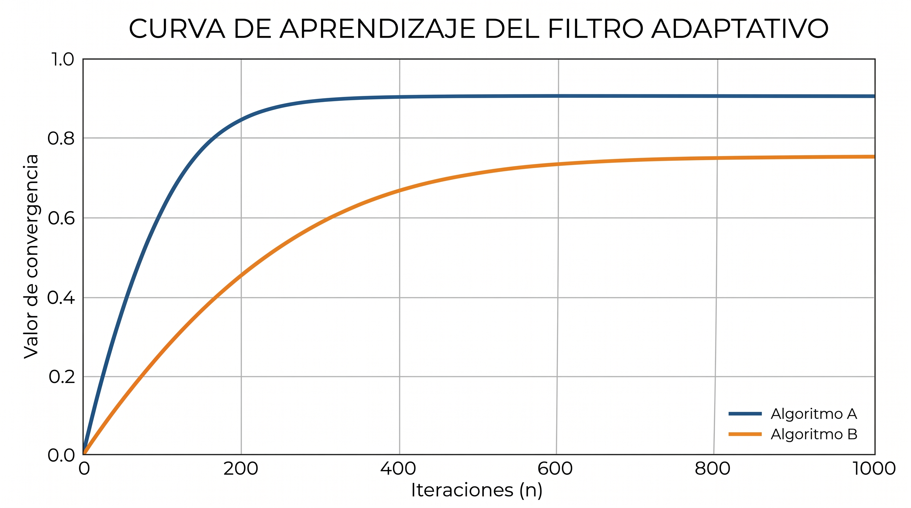
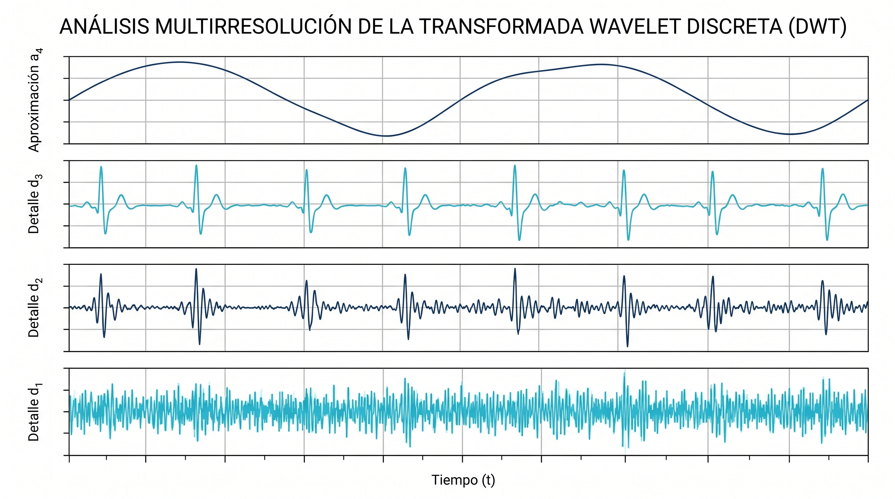
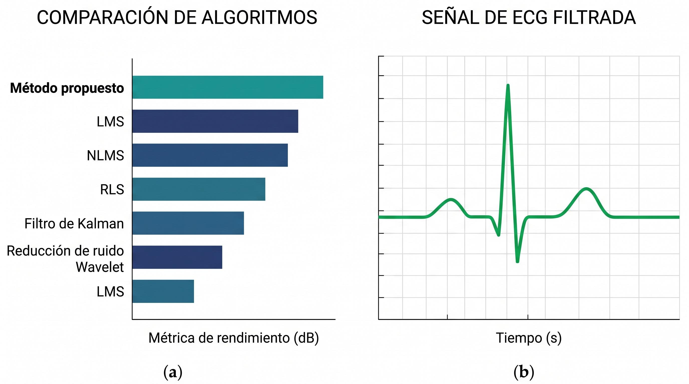

# Fundamentos de Filtrado y Transformada Wavelet en Señales de ECG Reales

## I. Adquisición y Naturaleza de la Señal ECG

El análisis de señales requiere comprender el origen y las características de los datos. El Electrocardiograma (ECG) refleja la actividad eléctrica del corazón, caracterizada por una morfología específica (ondas P, complejo QRS y onda T).

**Características del Registro:**
Un punto crucial en el procesamiento es que la mayor parte de la energía útil del ECG se concentra en bajas frecuencias (menores a 40 Hz).
En una adquisición real (como la obtenida mediante una placa BITalino y software OpenSignals en Derivación II tras 5 minutos de ejercicio):
*   Se utiliza un canal específico (ej. Canal A2).
*   La **frecuencia de muestreo** es típicamente alta (ej. 1000 Hz) para no perder detalles finos.
*   La señal cruda (en bits) debe convertirse a unidades físicas reales (mV) y centrarse en cero eliminando su media para facilitar el análisis matemático.

## II. El Problema del Ruido y la Contaminación

En entornos reales, la señal de interés rara vez está limpia. Se ve afectada por dos componentes no deseados principales:
1.  **Ruido:** Es aleatorio y afecta a todo el espectro, como el ruido gaussiano (que eleva el piso espectral en frecuencia) o el ruido muscular electromiográfico.
2.  **Interferencia:** Es una señal no deseada pero con una estructura y frecuencia muy identificables, siendo la más común la interferencia de la red eléctrica.

Para evaluar objetivamente los algoritmos de filtrado en un entorno controlado, es una práctica común realizar una **Contaminación Artificial**. Esto implica tomar un ECG original limpio y sumarle matemáticamente interferencias y ruido gaussiano de alta frecuencia. El espectro de frecuencias de esta señal contaminada revelará picos nítidos en las frecuencias de interferencia.

## III. Métodos de Filtrado Convencional y Adaptativo

Para recuperar la señal, existen diferentes aproximaciones matemáticas, cada una con un propósito específico:

### 1. Filtrado Pasa-Banda (Butterworth)
Es la primera línea de defensa. Se configura para permitir el paso solo de las frecuencias donde reside la energía útil del ECG. Atenúa simultáneamente las variaciones muy lentas y el ruido de alta frecuencia.

### 2. Filtrado Notch
Es un filtro de rechazo de banda extremadamente estrecho diseñado específicamente para eliminar frecuencias puntuales de interferencia (ej. 60 Hz) con la mínima distorsión posible en las frecuencias adyacentes.

### 3. Filtros Adaptativos (Algoritmo LMS)
A diferencia de los filtros anteriores, cuyos coeficientes son fijos, el filtro adaptativo LMS ajusta sus propios pesos ($w$) muestra a muestra para cancelar el ruido. Utiliza señales de referencia y evalúa el error en cada paso para actualizar la ecuación matemática. Es especialmente útil cuando las interferencias cambian en el tiempo.

## IV. La Transformada Wavelet Discreta (DWT)

Mientras los filtros convencionales actúan sobre la frecuencia global, la Transformada Wavelet localiza en el tiempo los componentes rápidos del ECG (como el QRS), separándolos del ruido y las interferencias.

El proceso de DWT descompone la señal en múltiples niveles de detalle (D) y una aproximación final (A).
Por ejemplo, con varios niveles de descomposición, obtenemos bandas específicas:
*   Las primeras bandas de detalle retienen el ruido de alta frecuencia.
*   Las bandas intermedias atrapan las interferencias eléctricas (ej. 60 Hz).
*   Bandas más profundas contienen la mayor parte de la energía de los eventos rápidos fisiológicos, especialmente el **complejo QRS**.
*   La Aproximación final retiene las frecuencias ultrabajas, representando la **deriva de la línea base**.

Para realizar el *denoising*, se aplica un umbral sobre los coeficientes de detalle, reduciendo el ruido gaussiano mientras se preserva la morfología de eventos útiles.

## V. Evaluación y Conclusiones del Filtrado

Para determinar qué método es superior, se debe evaluar métricamente utilizando la relación Señal-a-Ruido (**SNR**) y el coeficiente de correlación ($r$) con la señal original.

En un escenario práctico comparativo, un filtro Pasa-Banda suele ser robusto y puede obtener un SNR alto. Sin embargo, un enfoque híbrido (ej. Notch + Wavelet) suele ofrecer el mejor equilibrio: mantiene una altísima correlación con la señal original, logrando una excelente limpieza mientras preserva estrictamente la morfología fisiológica.

